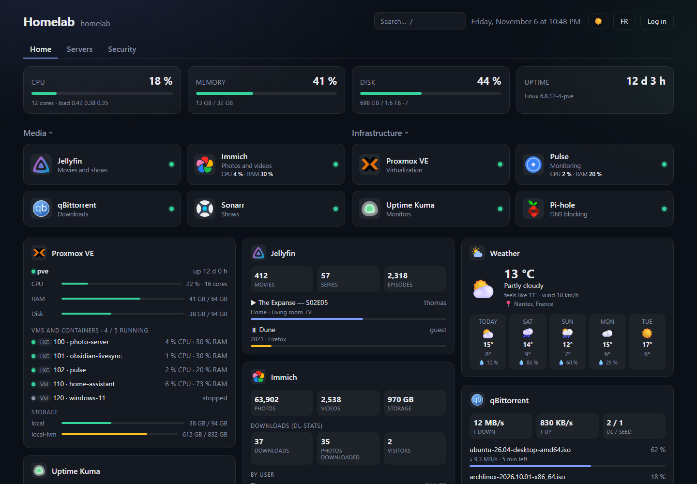
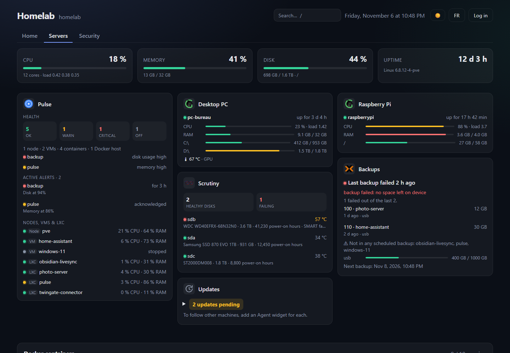
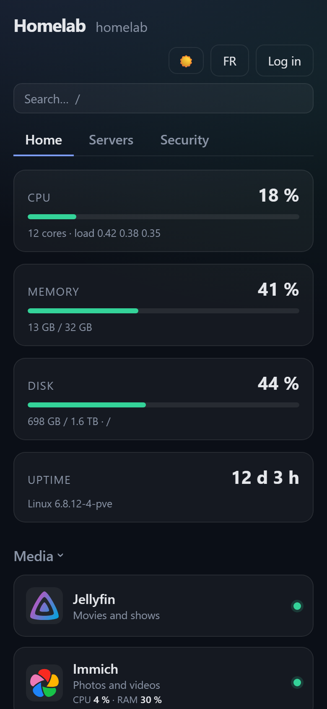

# Server Dashboard

**Your whole homelab on one page.** Your services, your machines, Docker and 40 widgets, in a lightweight dashboard you host yourself.

[](https://github.com/Circule-studio/server-dashboard/releases)
[](https://github.com/Circule-studio/server-dashboard/actions/workflows/ci.yml)
[](LICENSE)

🌐 [Project website](https://circule-studio.github.io/server-dashboard/en/) · 🇫🇷 [Version française](README.md) · 📖 [Guide](docs/GUIDE.en.md) · 🧩 [Widgets](docs/WIDGETS.en.md)



<details>
<summary>More screenshots</summary>





</details>

*Screenshots taken with the fake services from `npm run mocks`: the data is made up.*

## Why Server Dashboard

- **Everything in one place**: app tiles, tabs, bookmarks and keyboard search. Status is checked by the server, so LAN-only services work too.
- **Your machines at a glance**: server stats, Proxmox VE, Glances, or an agent that needs no open port.
- **Alerts, even with the page closed**: ntfy, Gotify, Discord or a webhook when an app goes down, a VM stops or a disk fills up.
- **Pending updates**: apt packages and Docker images, machine by machine. The dashboard shows them and installs nothing.
- **Docker at your fingertips**: the state of your containers, with start, stop and restart once logged in.
- **Everything is set in the interface**: drag and drop, light or dark theme, accent color, background image and alert thresholds, with no file to edit.
- **On your phone**: the interface adapts and installs like an app.
- **Light and readable**: Node.js with a single dependency (Express), no database and no build step. Your API keys stay on the server.

## 40 widgets

| Family | Services |
|---|---|
| **Servers and backups** | Proxmox VE, Proxmox Backup Server, Proxmox backups, script backup, Pulse, Glances, Agent, Updates, Scrutiny, Watchtower |
| **Media** | Jellyfin, Plex, qBittorrent, Sonarr, Radarr, Lidarr, Readarr, Prowlarr, Bazarr, Spotify, Immich |
| **Network and security** | Pi-hole, AdGuard Home, CrowdSec, Wazuh, Authelia, Traefik, Nginx Proxy Manager, Uptime Kuma, Speedtest Tracker |
| **Home and daily life** | Home Assistant, Frigate, Weather, iCal calendar, RSS / Atom feeds |
| **Web and development** | Loki / Grafana, GoAccess, Alwaysdata, GitHub, a custom API widget for everything else |

What each widget shows and where to find its credentials: [docs/WIDGETS.en.md](docs/WIDGETS.en.md).

## Installation

### Without Docker, in one command

As root, on Debian 12+ or Ubuntu 22.04+ with systemd. It also works in a Proxmox LXC container or on a Raspberry Pi:

```bash
curl -fsSL https://raw.githubusercontent.com/Circule-studio/server-dashboard/main/packaging/install.sh | sudo bash
```

The script installs Node.js if needed, creates a systemd service and prints the generated admin password once. Run the same command again to update.

### With Docker

The image is published for amd64 and arm64 (Raspberry Pi included):

```bash
mkdir server-dashboard && cd server-dashboard
curl -fsSLO https://raw.githubusercontent.com/Circule-studio/server-dashboard/main/compose.yaml
curl -fsSL https://raw.githubusercontent.com/Circule-studio/server-dashboard/main/.env.example -o .env
```

Open `.env`, replace `change-moi` with a real password, then run:

```bash
docker compose up -d
```

Either way, open `http://SERVER-IP:7575`: a welcome screen guides you. To update with Docker: `docker compose pull && docker compose up -d`.

### Before exposing it to the internet

By default, the dashboard can be read without logging in: only editing is protected. To open it to the outside, set `REQUIRE_LOGIN=true` and put it behind an HTTPS reverse proxy or a VPN. The Docker panel gives root-equivalent access to the host. Details: [Security](docs/GUIDE.en.md#security).

## Documentation

- [Guide](docs/GUIDE.en.md): features in detail, installation, disks, environment variables, security, API and development.
- [Widgets](docs/WIDGETS.en.md): what each widget shows and where to find its credentials.
- [Agent](agent/README.md) (in French): track a machine behind NAT or without an open port.
- [Changelog](CHANGELOG.md) (in French) and [published releases](https://github.com/Circule-studio/server-dashboard/releases).

## Contributing

The project is young and open to contributions: new widgets, interface, translations. Feedback from real services is also very useful ([#68](https://github.com/Circule-studio/server-dashboard/issues/68)). `npm run mocks` starts a fake service for each widget, so you can test everything without installing anything. Pull requests target the **`preprod`** branch. Details (in French) in [CONTRIBUTING.md](CONTRIBUTING.md); interface texts live in [`public/i18n.js`](public/i18n.js), add both French and English.

Found a vulnerability? Please report it privately, see [SECURITY.md](SECURITY.md).

## License

[MIT](LICENSE)
