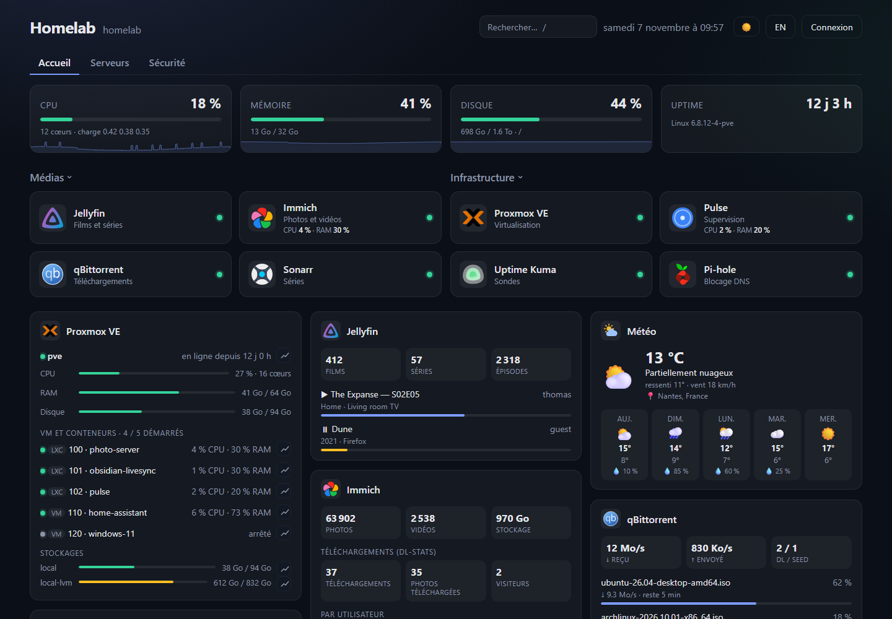
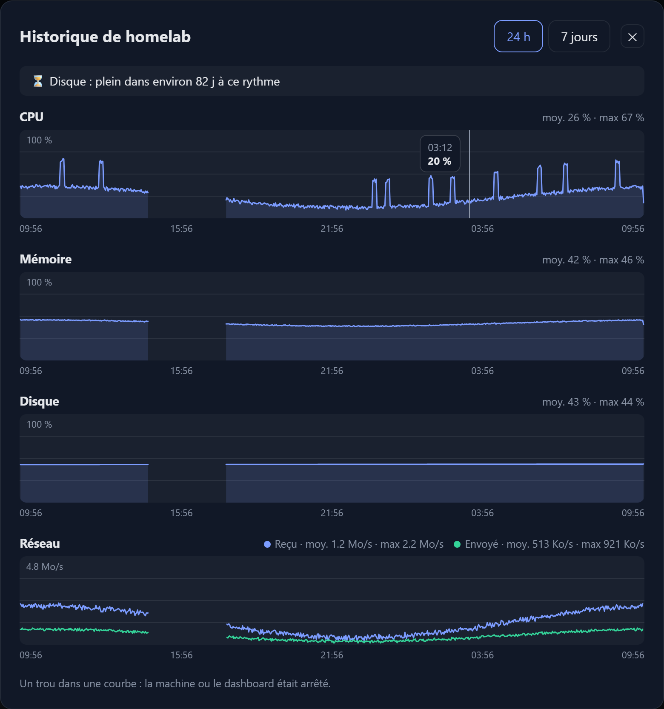
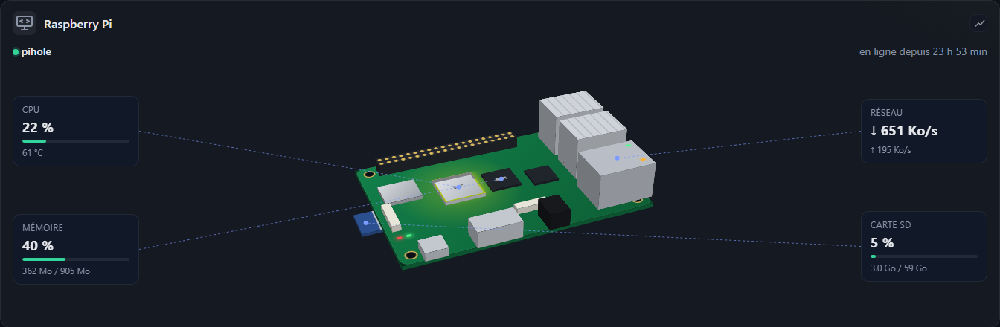
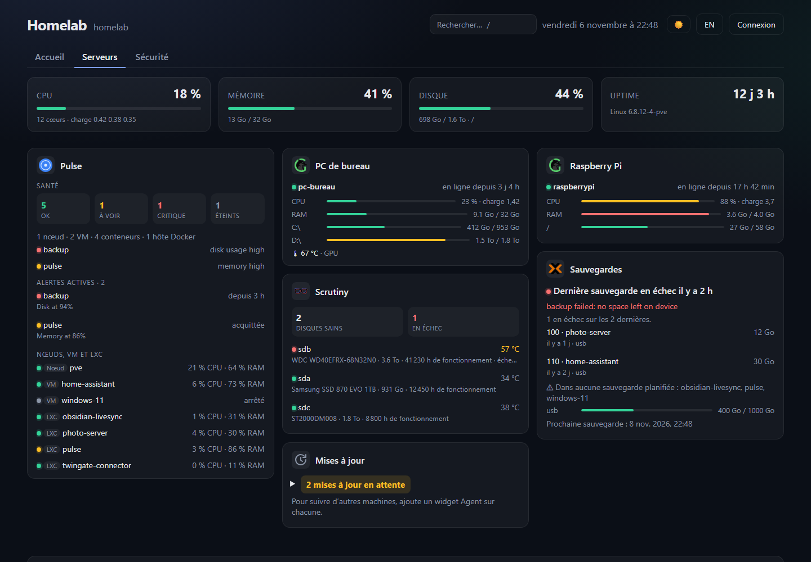
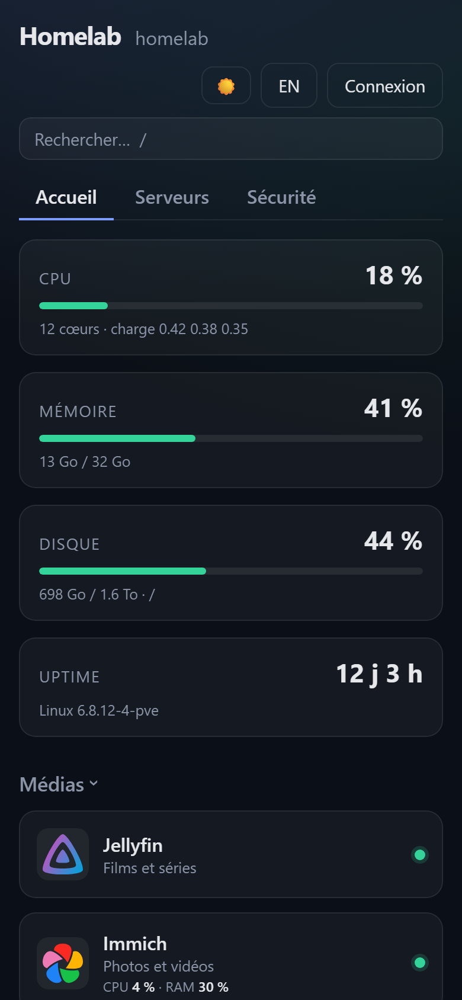

# Server Dashboard

**Tout ton homelab sur une seule page.** Tes services, tes machines, Docker et 40 widgets, dans un tableau de bord léger que tu héberges toi-même.

[](https://github.com/Circule-studio/server-dashboard/releases)
[](https://github.com/Circule-studio/server-dashboard/actions/workflows/ci.yml)
[](LICENSE)

🌐 [Site du projet](https://circule-studio.github.io/server-dashboard/) · 🇬🇧 [English version](README.md) · 📖 [Guide](docs/GUIDE.fr.md) · 🧩 [Widgets](docs/WIDGETS.fr.md)



<details>
<summary>Plus de captures</summary>









</details>

*Captures réalisées avec les faux services de `npm run mocks` : les données sont fictives.*

## Pourquoi Server Dashboard

- **Tout au même endroit** : tuiles d'applications, onglets, favoris et recherche au clavier. Le statut est vérifié par le serveur, services du réseau local compris.
- **Tes machines d'un coup d'œil** : stats du serveur, Proxmox VE, Glances, ou un agent qui ne demande aucun port ouvert.
- **Des courbes d'historique** : CPU, mémoire, disque et réseau sur 24 h et 7 jours, pour le serveur du dashboard, les agents, les machines et les stockages Proxmox. Une panne se voit comme un trou, et un disque qui se remplit a une estimation « plein dans environ N jours ».
- **Un Raspberry Pi en 3D** : une option du widget Agent affiche une maquette de la carte que tu peux faire tourner, animée par ses vraies valeurs.
- **Des alertes, même page fermée** : ntfy, Gotify, Discord ou webhook quand une application tombe, qu'une VM s'arrête ou qu'un disque se remplit.
- **Les mises à jour en attente** : paquets apt et images Docker, machine par machine. Le dashboard les montre, il n'installe rien.
- **Docker à portée de clic** : l'état de tes conteneurs, avec démarrage, arrêt et redémarrage une fois connecté.
- **Tout se règle dans l'interface** : glisser-déposer, thème clair ou sombre, couleur d'accent, image de fond et seuils d'alerte, sans fichier à éditer.
- **Sur ton téléphone** : l'interface s'adapte et s'installe comme une application.
- **Léger et lisible** : Node.js avec une seule dépendance (Express), sans base de données ni étape de build. Tes clés API restent sur le serveur.

## 40 widgets

| Famille | Services |
|---|---|
| **Serveurs et sauvegardes** | Proxmox VE, Proxmox Backup Server, sauvegardes Proxmox, sauvegarde par script, Pulse, Glances, Agent, Mises à jour, Scrutiny, Watchtower |
| **Médias** | Jellyfin, Plex, qBittorrent, Sonarr, Radarr, Lidarr, Readarr, Prowlarr, Bazarr, Spotify, Immich |
| **Réseau et sécurité** | Pi-hole, AdGuard Home, CrowdSec, Wazuh, Authelia, Traefik, Nginx Proxy Manager, Uptime Kuma, Speedtest Tracker |
| **Maison et quotidien** | Home Assistant, Frigate, Météo, Calendrier iCal, flux RSS / Atom |
| **Web et développement** | Loki / Grafana, GoAccess, Alwaysdata, GitHub, API personnalisée pour tout le reste |

Ce que montre chaque widget et où trouver ses identifiants : [docs/WIDGETS.fr.md](docs/WIDGETS.fr.md).

## Installation

### Sans Docker, en une commande

En root, sur Debian 12+ ou Ubuntu 22.04+ avec systemd. Ça marche aussi dans un conteneur LXC Proxmox ou sur un Raspberry Pi :

```bash
curl -fsSL https://raw.githubusercontent.com/Circule-studio/server-dashboard/main/packaging/install.sh | sudo bash
```

Le script installe Node.js si besoin, crée un service systemd et affiche une seule fois le mot de passe admin généré. Relance la même commande pour mettre à jour.

### Avec Docker

L'image est publiée pour amd64 et arm64 (Raspberry Pi compris) :

```bash
mkdir server-dashboard && cd server-dashboard
curl -fsSLO https://raw.githubusercontent.com/Circule-studio/server-dashboard/main/compose.yaml
curl -fsSL https://raw.githubusercontent.com/Circule-studio/server-dashboard/main/.env.example -o .env
```

Ouvre `.env`, remplace `change-moi` par un vrai mot de passe, puis lance :

```bash
docker compose up -d
```

Dans les deux cas, ouvre `http://IP-DU-SERVEUR:7575` : un écran d'accueil te guide. Mise à jour avec Docker : `docker compose pull && docker compose up -d`.

### Avant de l'exposer sur Internet

Par défaut, le dashboard est lisible sans connexion : seule la modification est protégée. Pour l'ouvrir à l'extérieur, mets `REQUIRE_LOGIN=true` et place-le derrière un reverse proxy en HTTPS ou un VPN. Le panneau Docker donne un accès équivalent à root sur l'hôte. Détails : [Sécurité](docs/GUIDE.fr.md#sécurité).

## Documentation

- [Guide](docs/GUIDE.fr.md) : fonctionnalités en détail, installation, disques, variables d'environnement, sécurité, API et développement.
- [Widgets](docs/WIDGETS.fr.md) : ce que montre chaque widget et où trouver ses identifiants.
- [Agent](agent/README.md) : suivre une machine derrière un NAT ou sans port ouvert.
- [Changelog](CHANGELOG.md) et [versions publiées](https://github.com/Circule-studio/server-dashboard/releases).

## Contribuer

Le projet est jeune et ouvert aux contributions : nouveaux widgets, interface, traductions. Tes retours avec de vrais services sont aussi très utiles ([#68](https://github.com/Circule-studio/server-dashboard/issues/68)). `npm run mocks` lance un faux service pour chaque widget, pour tout tester sans rien installer. Voir [CONTRIBUTING.md](CONTRIBUTING.md).

Une faille de sécurité ? Merci de la signaler en privé : voir [SECURITY.md](SECURITY.md).

## Licence

[MIT](LICENSE)
