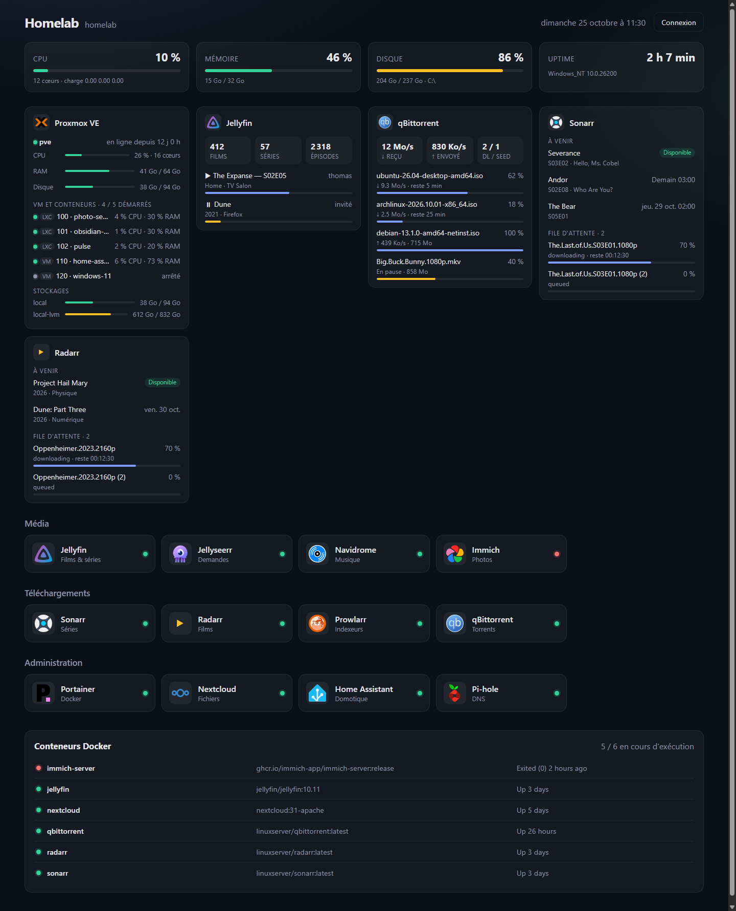
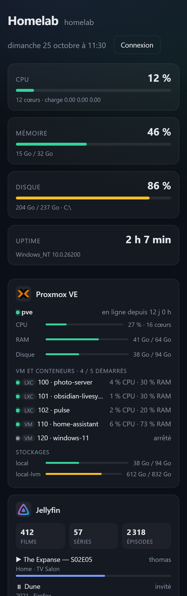

# Server Dashboard

Dashboard web auto-hébergé, dans l'esprit de Homarr, pour accéder aux services de ton serveur depuis une seule page.

**🌐 Site du projet : [circule-studio.github.io/server-dashboard](https://circule-studio.github.io/server-dashboard/)**



<details>
<summary>Version mobile</summary>



</details>

*Captures réalisées avec les faux services de `npm run mocks`.*

- **Tuiles d'applications** classées par catégories, avec icônes ([dashboardicons.com](https://dashboardicons.com)) et indicateur en ligne / hors ligne. Le ping est fait côté serveur, donc il marche aussi pour les services du réseau local.
- **Stats du serveur** : CPU, mémoire, disque, uptime (mises à jour toutes les 5 s).
- **Panneau Docker** : liste des conteneurs et leur état, avec démarrage, arrêt et redémarrage.
- **Widgets d'intégration** :
  - **Jellyfin / Plex** : lectures en cours (utilisateur, progression, pause) et taille de la bibliothèque.
  - **qBittorrent** : débits, torrents actifs, progression et temps restant.
  - **Sonarr / Radarr** : épisodes et films à venir, file de téléchargement.
  - **Proxmox VE** : stats de l’hôte, VM et conteneurs LXC, stockages.
- **Mode édition** protégé par mot de passe : ajouter, modifier ou supprimer des apps et des catégories, réordonner par glisser-déposer.

Stack : Node.js + Express côté serveur, HTML/CSS/JS sans étape de build côté client. La config est stockée dans `data/config.json`.

## Déploiement sur le serveur (Docker)

1. Copie le dossier sur le serveur (`git clone`, `scp`…).
2. Crée le fichier `.env` à partir du modèle et mets-y un vrai mot de passe :

   ```bash
   cp .env.example .env
   ```

   `.env` est ignoré par Git : ne mets jamais de mot de passe directement dans `docker-compose.yml`.
3. Lance :

   ```bash
   docker compose up -d --build
   ```

4. Ouvre `http://IP-DU-SERVEUR:7575` et clique sur **Connexion**, puis **Éditer** pour ajouter tes services.

Pour mettre à jour après une modification du code : `docker compose up -d --build`. La config reste dans `./data`.

## Installation sans Docker (Debian / Ubuntu, LXC Proxmox)

Une commande, en root, sur Debian 12+ ou Ubuntu 22.04+ avec systemd. Ça marche aussi dans un conteneur LXC Proxmox ou sur un Raspberry Pi :

```bash
curl -fsSL https://raw.githubusercontent.com/Circule-studio/server-dashboard/main/packaging/install.sh | sudo bash
```

Le script :
- installe Node.js 22 si besoin ;
- télécharge la dernière release dans `/opt/server-dashboard` ;
- crée un utilisateur système `server-dashboard` et un service systemd du même nom ;
- génère un mot de passe admin et l'affiche une seule fois.

| Quoi | Où |
|---|---|
| Réglages (mot de passe, port, `REQUIRE_LOGIN`…) | `/etc/server-dashboard/server-dashboard.env`, puis `sudo systemctl restart server-dashboard` |
| Config du dashboard (tuiles, widgets) | `/var/lib/server-dashboard/` |
| Logs | `journalctl -u server-dashboard -f` |

- **Mettre à jour** : relance la même commande. La config et les réglages sont conservés.
- **Choisir une version, un port ou un mot de passe** à la première installation : `… | sudo SD_VERSION=v0.1.0 SD_PORT=8080 SD_ADMIN_PASSWORD=… bash`
- **Désinstaller** : `… | sudo bash -s -- --uninstall` (ajoute `--purge` pour effacer aussi la config).
- **Panneau Docker** : si Docker est installé sur la machine, le service est ajouté au groupe `docker`. Sinon, le panneau est simplement masqué.

## Développement en local

```bash
npm install
npm run dev
```

Puis ouvre http://localhost:7575 (mot de passe par défaut : `admin`).

Pour travailler sur les widgets sans avoir les vrais services, lance de faux Jellyfin, qBittorrent, Sonarr et Radarr dans un second terminal :

```bash
npm run mocks
```

Les URL et clés de test à saisir sont en tête de [dev/mocks.js](dev/mocks.js).

## Widgets : où trouver les identifiants

| Service | Champs | Où les trouver |
|---|---|---|
| Jellyfin | URL + clé API | Tableau de bord > Clés API > « + » |
| Plex | URL + token | Valeur `X-Plex-Token` ([doc Plex](https://support.plex.tv/articles/204059436-finding-an-authentication-token-x-plex-token/)) |
| qBittorrent | URL + utilisateur / mot de passe de la WebUI | Options > Interface web |
| Sonarr / Radarr | URL + clé API | Settings > General > API Key |
| Proxmox VE | URL (`https://IP:8006`) + identifiant et secret d’un jeton d’API | Voir ci-dessous |

**Proxmox VE** : le widget affiche les stats de l’hôte (CPU, RAM, disque), l’état de toutes les VM et conteneurs LXC, et les stockages. C’est la façon de voir la machine complète quand le dashboard tourne lui-même dans un LXC, qui ne voit que ses propres limites. Crée un jeton en **lecture seule** dans le shell de l’hôte Proxmox :

```bash
pveum user token add root@pam dashboard --privsep 1
pveum acl modify / --tokens "root@pam!dashboard" --roles PVEAuditor
```

La première commande affiche le secret (une seule fois). Dans le widget : identifiant `root@pam!dashboard`, secret = la valeur `value` affichée.

Les URL doivent être joignables **depuis le serveur du dashboard** (par exemple `http://jellyfin:8096` si les deux sont dans le même réseau Docker). Les clés et mots de passe restent sur le serveur : ils ne sont jamais renvoyés au navigateur.

## Versions

Les versions stables sont publiées dans les [Releases](https://github.com/Circule-studio/server-dashboard/releases), et le détail des changements est dans le [CHANGELOG](CHANGELOG.md). Pour publier une version : mettre à jour `version` dans `package.json` et `CHANGELOG.md`, fusionner dans `main`, puis pousser un tag `vX.Y.Z`. Le workflow `release.yml` crée la release.

## Contribuer

Les contributions sont bienvenues, en particulier sur l'interface. Voir [CONTRIBUTING.md](CONTRIBUTING.md).

## Variables d'environnement

| Variable | Défaut | Rôle |
|---|---|---|
| `PORT` | `7575` | Port HTTP |
| `ADMIN_PASSWORD` | `admin` | Mot de passe du mode édition |
| `DATA_DIR` | `./data` | Dossier de la config et du secret de session |
| `SERVER_NAME` | nom de la machine | Nom affiché à côté du titre (utile en Docker) |
| `DISK_PATH` | `/` (`C:\` sous Windows) | Chemin dont on affiche l'occupation disque |
| `DOCKER_SOCKET` | `/var/run/docker.sock` | Socket de l'API Docker |
| `REQUIRE_LOGIN` | `false` | `true` : tout le dashboard (lecture comprise) exige d’être connecté |
| `TRUST_PROXY` | – | Derrière un reverse proxy, mettre `1` pour que la limite de tentatives de connexion voie la vraie IP des visiteurs |
| `SESSION_SECRET` | généré dans `data/.secret` | Clé de signature des cookies de session |

## Sécurité

- Les tentatives de connexion sont limitées à 10 par IP toutes les 15 minutes. Changer `ADMIN_PASSWORD` déconnecte toutes les sessions ouvertes.
- Par défaut, le dashboard est lisible sans connexion (seule la modification est protégée). Si tu l’exposes en dehors de ton réseau, mets `REQUIRE_LOGIN=true`.
- Monter `/var/run/docker.sock` donne au conteneur un accès équivalent à root sur l'hôte. Les actions Docker exigent d'être connecté, mais n'expose pas le dashboard directement sur Internet : place-le derrière un reverse proxy en HTTPS (Nginx Proxy Manager, Caddy, Traefik) ou derrière un VPN (WireGuard, Tailscale).
- Pour un panneau Docker en lecture seule, utilise un proxy de socket comme `tecnativa/docker-socket-proxy` et pointe `DOCKER_SOCKET` dessus (ou retire simplement le volume).

## API

| Méthode | Route | Auth |
|---|---|---|
| GET | `/api/config` | – |
| PUT | `/api/config` | ✔ |
| GET | `/api/status` | – |
| GET | `/api/system` | – |
| GET | `/api/widgets/:id` | – |
| GET | `/api/docker/containers` | – |
| POST | `/api/docker/containers/:id/(start\|stop\|restart)` | ✔ |
| POST | `/api/login`, `/api/logout` · GET `/api/me` | – |
